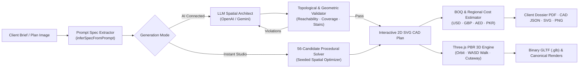

<div align="center">

# 🏗️ ForthHome Studio
### AI & Spatial Constraint Architectural Concept Engine

**Turn natural-language residential briefs into machine-validated 2D floor plans, walkable Three.js PBR 3D models, regional BOQ cost estimates, and client presentation dossiers.**

[](https://www.typescriptlang.org/)
[](https://threejs.org/)
[](./tests)
[](https://github.com/UsmanQasim)

</div>

---

## ✨ Why ForthHome?

Most "AI floor plan generators" produce raster images with impossible geometry—doors that lead nowhere, overlapping rooms, unaligned stairs across floors, or missing windows. **ForthHome is a CAD-first spatial studio:**

1. **Dual-Engine Spatial Generation**
   - **LLM + Constraint Feedback Loop (`/api/ai/floor-plan`)**: Prompts OpenAI / Gemini for axis-aligned room geometry, validates it against topological and dimensional invariants, and feeds back specific violations for automatic self-correction.
   - **Deterministic 56-Candidate Procedural Solver (`Instant Studio Draft`)**: Evaluates 56 seeded architectural topologies in `<100ms` on the client or server, scoring circulation efficiency, daylight access, and room proportions—working 100% offline with zero API cost.
2. **Hard Architectural Invariants (`src/engine/layout.ts`)**
   - **Zero Overlaps & Full Footprint Tiling**: Verified via geometric union coverage ($\ge 85\%$ required).
   - **Graph Reachability**: BFS traversal guarantees every habitable room is reachable from the front entrance and upper-floor landings via physical doorways.
   - **Multi-Storey Stairwell Alignment**: Stacked stair cores automatically align across levels and cut corresponding upper-floor slabs and lower ceilings in 3D.
   - **Exterior-Only Fenestration**: Windows are placed strictly on outer building perimeter walls.
3. **Real-Time Walkable PBR 3D Studio (`src/engine/house3d.ts`, `viewer.ts`)**
   - Extrudes validated 2D plans into a full Three.js scene with procedural rooms, doors, glazing, roof geometry, and collision-checked WASD first-person walkthroughs + orbit cutaway views.
   - Exports standard binary **`.glb` (GLTF 2.0)** assets ready for Blender, Unreal, Unity, or web embeds.
4. **Parametric BOQ & Multi-Market Construction Cost Estimator (`src/engine/estimator.ts`)**
   - Real-time quantity takeoffs: Gross Floor Area (GFA), Net Habitable Area, circulation efficiency, exterior/interior linear wall lengths, and glazing apertures.
   - Regional unit-rate pricing across **USA (USD)**, **UK (GBP)**, **UAE / GCC (AED)**, and **Pakistan (PKR)** with **Essential**, **Signature**, and **Bespoke Luxury** finish tiers.
   - Five-division Bill of Quantities (Substructure & Frame, Envelope & Glazing, Partitions & Millwork, MEP Systems, Finishes) + one-click **Client Dossier PDF** and **CAD/BOQ JSON** export.

---

## 🏛️ System Architecture



---

## 🚀 Quick Start

Requires **Node.js 18+**.

```bash
# 1. Install dependencies
npm install

# 2. Optional: configure AI keys for LLM bespoke plans & photorealistic renders
cp .env.example .env

# 3. Build & start the studio server (http://localhost:3000)
npm run dev
```

> **Note:** Even without an `OPENAI_API_KEY` or `GEMINI_API_KEY`, ForthHome's **⚡ Instant Studio Draft (56-Candidate Procedural Solver)**, **3D Walkthrough**, **GLB Export**, **BOQ Cost Estimator**, and **Client Dossier PDF** work out of the box.

### Verification & Test Suite

```bash
npm run typecheck   # Strict TypeScript verification (client + server)
npm test            # 43 architectural invariant, provider & BOQ unit tests
npm run build       # Production server + Vite client bundle
```

---

## 💼 Commercial & B2B Workflow

ForthHome is designed for **residential architects, design-build contractors, and real-estate developers** who need to move from initial client discovery to an aligned spatial concept and preliminary budget in a single 10-minute meeting:

1. **01 · Create**: Capture plot dimensions (`6m–80m`), storey count (`1–4`), room program, custom spaces (`Home Office`, `Prayer Room`, `Gym`, `Pantry`), and architectural character.
2. **02 · Plan & BOQ**: Inspect the dimensioned 2D floor plan across levels, verify the 5-point architectural quality score, switch between regional currencies/finish tiers, and print the **Client Dossier PDF**.
3. **03 · Visualize**: Walk the client through the furnished 3D model in Orbit or first-person WASD mode, toggle floor cutaways and evening lighting, or export `.glb`.
4. **04 · Present**: Generate plan-anchored exterior and interior architectural visualizations conditioned on the exact 2D plan and 3D viewport capture.

---

## 📄 Scope & Professional Disclaimer

Exported plans, 3D models, and BOQ schedules are preliminary concept assets for feasibility, client alignment, and visualization. They are not stamped construction documents; always verify structural engineering, local zoning setbacks, and building codes with a licensed architect and engineer.
